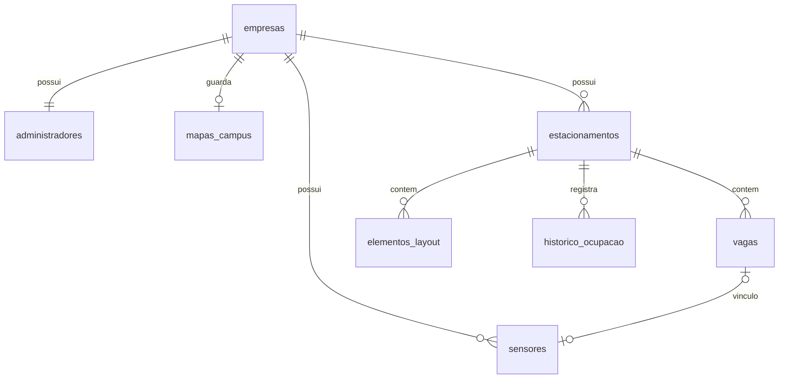

# Backend e banco — proposta simples para o MVP

Status: **planejamento**. O frontend já demonstra cadastro de empresa e consulta pública via MSW;
a API real e o banco ainda não foram implementados. O SQL proposto não foi aplicado a um PostgreSQL.

## Quem usa

- Visitante: abre o campus e consulta vagas. Não tem conta, senha, role, veículo ou favorito.
- Empresa: cadastra seu responsável, que gerencia mapa, bolsões, vagas e sensores.

Um responsável e um campus por empresa no MVP. Sem tabela de motoristas ou sistema de convites.
Cada empresa tem endereço `/c/{slug}`. A consulta de todos os campi é livre desde o cadastro,
sem aprovação ou controle de visibilidade. Login é exigido para o painel, cadastro/edição de espaços,
mapas e sensores. O seed Unisagrado tem dados apenas demonstrativos.

## Tecnologia e organização

Proposta: um aplicativo FastAPI, SQLAlchemy com sessões síncronas, PostgreSQL e migrações Alembic.
Uma transação por escrita. Polling de 3 segundos, como hoje. Sem microserviços, Redis ou WebSocket.
Essas são escolhas para o projeto, apoiadas nas capacidades documentadas de
[sessões SQLAlchemy](https://docs.sqlalchemy.org/en/20/orm/session_basics.html),
[migrações Alembic](https://alembic.sqlalchemy.org/en/latest/tutorial.html) e
[JSONB no PostgreSQL](https://www.postgresql.org/docs/current/datatype-json.html).

Estrutura a criar ao implementar a API:

```text
backend/
  app/
    main.py, config.py, db.py
    models.py, schemas.py, auth.py
    routers/
      auth.py, empresa.py, publico.py
      estacionamentos.py, sensores.py, dispositivo.py
    services/
      layout.py, mapa.py, ocupacao.py
  migrations/           # Alembic
  tests/
  database/             # propostas já presentes
```

Routers chamam serviços para transações ou cálculos compartilhados. Não criar repositórios genéricos
ou camadas extras no MVP. Modelos Python usam snake_case e schemas Pydantic expõem camelCase.

## Banco

O desenho completo está em [schema.proposta.sql](../backend/database/schema.proposta.sql).

| Tabela | Guarda |
| --- | --- |
| empresas | Nome e slug |
| administradores | Responsável, e-mail e hash da senha; sem role |
| mapas_campus | Cena local 2,5D, GeoJSON opcional para levantamento, versão e atualização; um mapa por empresa |
| estacionamentos | Bolsões, acesso, caminhada, coordenadas e dimensões do layout |
| vagas | Rótulo, tipo, posição, tamanho e rotação |
| elementos_layout | Vias, entradas, saídas e textos do bolsão |
| sensores | Vínculo a uma vaga, hash da chave e última leitura |
| historico_ocupacao | Amostras para gráficos, sem armazenar cada heartbeat |



Chaves estrangeiras compostas impedem vínculo entre empresas diferentes. Rótulo é único no bolsão,
e uma vaga recebe no máximo um sensor. O servidor obtém a empresa da sessão, não do corpo enviado
pelo navegador. Substituir/excluir layout primeiro desvincula sensores na mesma transação.

Histórico: uma amostra por bolsão a cada 5 minutos, com total, livres, ocupadas e sem sinal. Leituras
atualizam a amostra do intervalo por UPSERT. Uma tarefa simples também registra os intervalos sem
movimento para refletir sensores expirados. Gráficos agregam as amostras por hora/dia. Retenção inicial:
14 dias, com limpeza diária. Não é necessário guardar cada heartbeat ou adicionar fila.

## O mapa da Unisagrado ficará salvo no banco

São dois desenhos distintos:

1. **Campus real:** [GeoJSON (RFC 7946)](https://datatracker.ietf.org/doc/html/rfc7946) em longitude/latitude WGS84, salvo em `mapas_campus.geojson` (JSONB).
   Portões são Point, vias LineString, e blocos/limites dos bolsões Polygon.
2. **Vagas de cada bolsão:** coordenadas lógicas x/y, tamanho e rotação nas tabelas `vagas` e
   `elementos_layout`, preservando o editor existente.

A feature BOLSAO liga o polígono a `properties.estacionamentoId`. O frontend desenha os vetores do
banco e combina a disponibilidade. Tiles externos são opcionais; o desenho próprio não depende deles.
PostGIS pode ser avaliado se surgir cálculo espacial no servidor; não é necessário para este armazenamento.

- [Formato do mapa](../backend/database/mapa-campus.schema.json)
- [Arquivo inicial vazio](../backend/database/mapa-unisagrado.inicial.geojson)

O grupo ainda levantará e validará portões, vias, blocos e bolsões reais. O arquivo começa vazio;
as coordenadas do seed não substituem esse levantamento. Tempos a pé e acessos devem ser conferidos.
O importador/editor do mapa completo ainda será implementado.

A consulta agora também demonstra uma **cena 2,5D em coordenadas locais**, aproximada da imagem
marcada pelo grupo. `mapas_campus.cena` (JSONB) guardará polígonos, alturas ilustrativas, vias,
portões e posições individuais vinculadas por `vagaId`. O mock já persiste esse objeto e o entrega
por HTTP; a geometria é projetada em SVG pelo frontend. Não exige tiles, WebGL ou um modelo 3D externo.
O GeoJSON acima permanece vazio até um levantamento geográfico real: não é o sistema de coordenadas
da ilustração. Implementação, limites e validações adicionais estão em [MAPA_CAMPUS.md](MAPA_CAMPUS.md).

O visitante vê um campus contínuo, sem escolher bolsões. Os grupos e o editor existentes permanecem
na administração para preservar cadastros e vínculos dos sensores. Vagas ainda sem posição na cena
devem ser informadas como não mapeadas, sem gerar uma localização automaticamente.

Validações previstas: JSON Schema, IDs únicos, pontos dentro dos limites de longitude/latitude,
anéis fechados dos polígonos e `estacionamentoId` pertencente à empresa. Limitar tamanho do arquivo
e quantidade de pontos. O JSON Schema cobre a forma; as demais regras pertencem ao serviço.
Salvar usa `{ versao, geojson }`, atualiza em transação e incrementa a versão; conflito devolve 409.
Na API real, fazer o mesmo com `layoutVersao` para evitar sobrescrita entre abas.

## API e proteção

O [contrato atual](api-contract.md) separa rotas públicas de rotas da empresa. A consulta pública só
retorna nome, geometria e disponibilidade dos campi cadastrados. Não retorna e-mail, senha/hash,
sensorId ou chaves. Escritas públicas, analytics e cadastro de sensores são bloqueados.

Consulta já implementada no mock:

- GET `/publico/campi/{slug}/mapa`: `{ mapa, vagas, vagasSemPosicao }`, cena e disponibilidade de toda a empresa.

Escrita planejada para a API real, ainda ausente do mock:

- GET/PUT `/empresa/mapa`: ler/salvar o próprio mapa; PUT recebe versão, cena e GeoJSON.

Cadastro de empresa, responsável e mapa vazio será uma transação. Login real usará hash Argon2 e
token de acesso com prazo curto, seguindo a abordagem documentada pelo
[FastAPI](https://fastapi.tiangolo.com/tutorial/security/oauth2-jwt/). O servidor resolve a empresa pelo
responsável autenticado. Chaves de sensor serão aleatórias, exibidas uma vez e guardadas como hash.

O dispositivo usará PUT `/dispositivo/vagas/{id}/status` com `X-Device-Key` do sensor vinculado.
Envia LIVRE ou OCUPADA. A API usa a hora de recebimento para `ultimo_sinal_em`; sem sensor ou sem
leitura há mais de 60 segundos, a consulta calcula SEM_SINAL. Não há lançamento de ocupação pelo visitante.

## Próximas entregas

1. FastAPI, configuração por ambiente, PostgreSQL de desenvolvimento e primeira migração.
2. Cadastro/login do responsável e testes de isolamento de empresa.
3. Consultas públicas permanentes com DTOs sem dados internos.
4. CRUDs, layout atômico e importação do mapa GeoJSON com controle de versão.
5. Dispositivos, expiração de sinal, histórico e analytics.
6. Trocar `VITE_USE_MOCK=false`, validar o contrato e testar com os sensores reais.

Reservas, pagamentos e cadastro de motoristas ficam fora deste MVP. Rotas internas dependem de
levantamento de entradas, sentidos de circulação e caminhos de pedestres. A demonstração atual
somente destaca o portão e ordena proximidade no desenho, sem calcular percursos.
