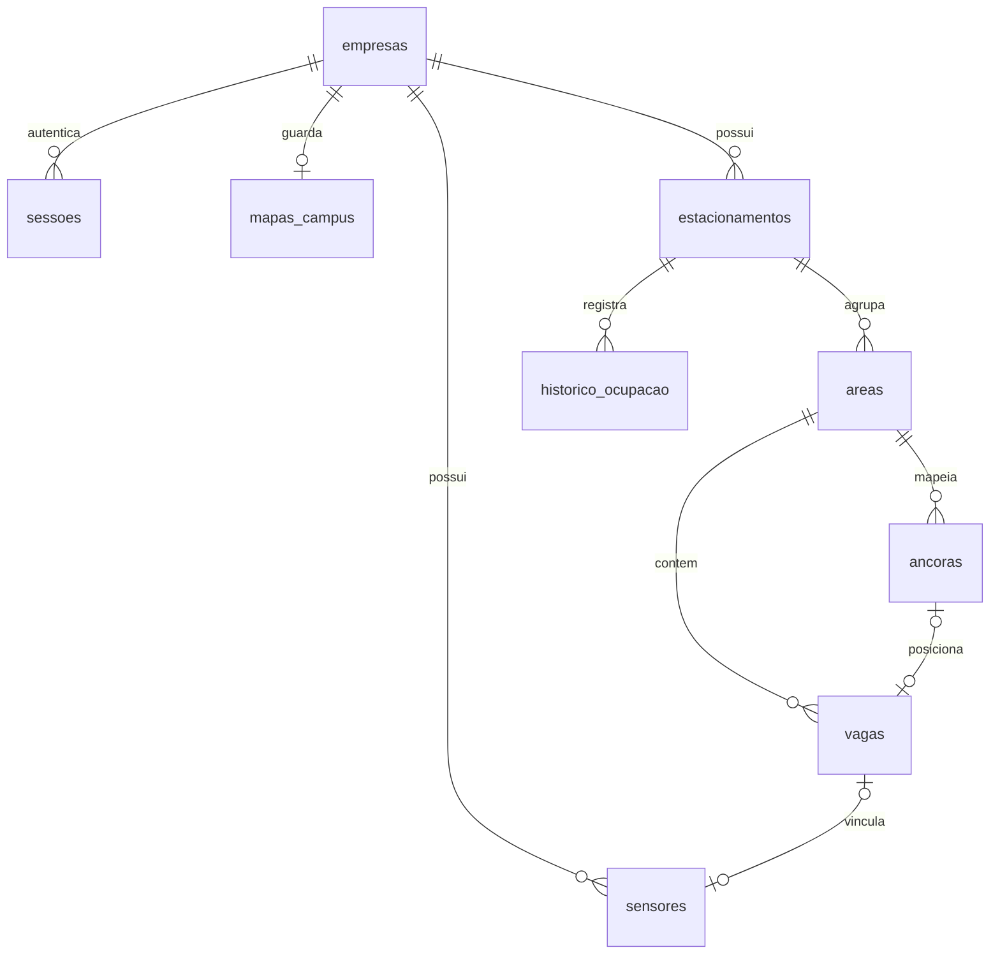

# Backend e banco — v2

Status: **contrato implementado em FastAPI + PostgreSQL**, com migrações `0001`/`0002` aplicadas e
testadas (upgrade/downgrade) em PostgreSQL 17. O frontend continua com MSW por padrão e funciona
contra a API real com `VITE_USE_MOCK=false`. Sensores físicos (ESP32) ainda não foram construídos.
Comandos em [backend/README.md](../backend/README.md) e continuidade em [HANDOFF.md](HANDOFF.md).

## Modelo de acesso

Visitantes abrem a Unisagrado diretamente em `/`; outras empresas usam `/c/{slug}`.
O alias `/c/unisagrado` preserva filtros ao redirecionar para `/`. A consulta não exige conta.
Destino, favoritos e aviso de vaga ficam no aparelho.
Cada empresa tem uma conta no MVP: nome, slug, e-mail e senha. Não há papéis nem tabela de motoristas.
A consulta é sempre pública, inclusive para empresas recém-cadastradas. Apenas a gestão exige sessão.

Na API privada, a empresa vem do token validado. O servidor nunca aceita `empresaId` do corpo
como autorização. Consultas e alterações usam esse escopo em todos os recursos relacionados;
IDs de outra empresa retornam 404. A guarda React ajuda a navegação, mas não substitui autorização.
O mock demonstra esse isolamento; credenciais locais fictícias não oferecem segurança de produção.

## Estrutura simples

Manter a proposta existente: uma aplicação FastAPI, SQLAlchemy, PostgreSQL e Alembic.
Uma transação por escrita, sem microserviços, fila, Redis ou WebSocket no MVP.

```text
backend/
  app/
    main.py, config.py, db.py, models.py, schemas.py, errors.py
    auth.py, security.py, seed.py
    routers/     # conta, publico, estacionamentos, areas (+vagas), sensores (+leituras, simulador)
    services/    # consulta (DTOs), posicionamento, ocupacao
  migrations/    # 0001 esquema v2, 0002 campos do contrato
  tests/         # infraestrutura + integração em PostgreSQL (batsinal_test)
  database/      # SQL de referência, seed exportado do mock, GeoJSON vazio
  scripts/       # exportador do seed a partir do mock
```

Schemas da API usam camelCase; modelos/tabelas, snake_case. O contrato demonstrado está em
[api-contract.md](api-contract.md). O frontend acessa HTTP, nunca o banco diretamente.

## Dados

| Tabela | Responsabilidade |
| --- | --- |
| empresas | Conta única, nome, slug, e-mail e hash da senha |
| sessoes | Hash de token opaco, empresa e vencimento |
| mapas_campus | Geometria local de prédios/portões/vias em JSONB; GeoJSON futuro separado |
| estacionamentos | Agrupamento administrativo, acesso e coordenadas opcionais |
| areas | Trecho mapeado, contorno e versão de posicionamento |
| ancoras | Posições fixas levantadas: x/z, rotação, dimensões e tipos aceitos |
| vagas | Rótulo, tipo, área e ancora_id opcional; sem coordenadas livres |
| sensores | Dispositivo, vínculo único à vaga, hash da chave e última leitura |
| historico_ocupacao | Amostras agregadas para painel |



[schema.proposta.sql](../backend/database/schema.proposta.sql), congelado na revisão Alembic inicial,
usa chaves estrangeiras compostas
para impedir cruzamento de empresas/áreas. Uma âncora recebe no máximo uma vaga; rótulo é único
no estacionamento, sem diferença de caixa. A compatibilidade de tipo é validada no serviço,
pois depende da linha da âncora. Não há tabela de elementos de editor livre.

## Posicionar e trocar

1. Resolver a empresa pela sessão e abrir transação.
2. Buscar a área da própria empresa com bloqueio de linha (`SELECT ... FOR UPDATE`).
3. Exigir a versão enviada e comparar com a atual; responder 409 se divergente.
4. Validar peça, destino, tipo e eventual peça deslocada. A origem da bandeja desloca a outra peça
   para a bandeja; origem posicionada troca os vínculos, validando ambos os tipos.
5. Alterar os vínculos, incrementar a versão e confirmar a transação.

A restrição única de âncora é adiada até o fim da transação para permitir troca. O lote completo
usado por desfazer/refazer passa pelas mesmas validações; nunca é uma sequência de escritas parciais.
Restaurar padrão usa `ancoras.vaga_padrao_id`, sem recriar geometrias ou posicionar peças novas.
Ao excluir vaga, desvincular sensor e padrão na mesma transação. Área com vagas exige esvaziamento
antes da exclusão. Exclusão de estacionamento também limpa os vínculos dos seus sensores.

No mock, cada handler valida antes de alterar, verifica versão quando enviada e reverte gravação
se o armazenamento local falha. Isso não equivale a bloqueio concorrente de banco: abas simultâneas
ainda podem disputar o localStorage. A versão será obrigatória nas escritas da API real.

## Mapa da Unisagrado salvo no banco

O mapa aproximado atual é a base do grupo. Seus vetores originais foram preservados, e as 92
posições existentes deram origem às âncoras. O seed novo deixa três peças na bandeja; migrações
conservam posições e sensores anteriores. A geometria da ilustração não tem escala em metros.

`mapas_campus.cena` guardará blocos com alturas ilustrativas, portões, vias e limites locais.
Áreas/âncoras ficam nas tabelas próprias. A API monta o mapa combinando geometria e posições atuais;
as posições do seed são referência do padrão, não uma segunda fonte do estado atual.
O objeto de cena não contém senhas, chaves nem estado de ocupação.

`geojson` é reservado ao levantamento geográfico real em longitude/latitude WGS84. O arquivo
[inicial](../backend/database/mapa-unisagrado.inicial.geojson) continua vazio. Não estimar coordenadas
geográficas a partir da ilustração. O [schema GeoJSON](../backend/database/mapa-campus.schema.json)
não substitui validação das posições locais.

O frontend já importa âncoras levantadas em JSON na criação de uma área, sem gerador automático.
Importador completo de prédios/portões/vias e validação geográfica continuam como trabalho futuro.

## Leituras e segurança da implementação futura

Polling de 3 s. Sem leitura válida há mais de 60 s ou sem sensor: SEM_SINAL. Leituras não podem
mover peças. Ocupação representa indisponibilidade (ocupada + sem sinal), como no painel atual.
Proposta: amostra por estacionamento a cada 5 min, UPSERT do intervalo, retenção inicial de 14 dias;
registrar também intervalos sem movimento para refletir expiração de sensores.

Na API real, usar hash de senha resistente, token opaco aleatório com hash no banco e expiração,
invalidar sessões anteriores ao trocar senha e revogar a sessão no logout. Guardar hash das chaves
dos dispositivos e exibir a chave uma única vez. DTO público deve listar campos explicitamente.
Validar importações (coordenadas finitas e limitadas, IDs, contornos e tipos) no servidor.
Criar migrações Alembic preservando contas, mapas, vagas e sensores; o SQL proposto não deve ser
executado como atualização direta de um banco antigo.

## Decisões da implementação

- **Senhas**: `hashlib.scrypt` (n=2^14, r=8, p=1, salt de 16 bytes), parâmetros gravados no hash.
  Login com e-mail inexistente também calcula um hash, para tempo semelhante.
- **Sessões**: token opaco de 256 bits; o banco guarda SHA-256 e `expira_em` (7 dias, configurável).
  `POST /auth/logout` apaga a sessão; trocar a senha apaga as demais.
- **Dispositivos**: `POST /leituras` com `X-Device-Key`; chave `bs_...` de 256 bits, só o hash no banco.
  `ultimo_status` NULL também significa SEM_SINAL (usado pelo simulador).
- **Posicionamento**: `SELECT ... FOR UPDATE` na área, versão obrigatória, lote validado antes de alterar.
  Criar/editar/excluir vaga também bloqueia a área e incrementa a versão. Um teste concorrente garante
  que dois movimentos com a mesma versão resultam em um 200 e um 409.
- **Histórico**: tarefa assíncrona no processo da API (sem fila), a cada 10 s, faz UPSERT da amostra
  do intervalo de 5 min e apaga o que passou de 14 dias. Leituras também atualizam a amostra na hora.
  Ocupação por hora/dia usa `date_trunc` com o fuso `America/Sao_Paulo` (PostgreSQL 16+).
- **Mapa**: `mapas_campus.cena` guarda a cena do mock com IDs de áreas/vagas convertidos para UUID.
  A resposta substitui os nomes das áreas pelos atuais e omite áreas excluídas.
- **Simulador**: `BATSINAL_SIMULADOR=true` libera `/simulador/leituras` e repete leituras dos sensores
  simulados, como o heartbeat do mock. Deve ficar desligado com sensores reais.
- **ORM**: alinhado às colunas das migrações; constraints compostas ficam só nas migrações, por isso
  o autogenerate segue desligado (`target_metadata = None`).

## Próximos passos

1. Firmware do ESP32 enviando `POST /leituras` periodicamente (ver `hardware/README.md`).
2. Validar no campus posições, tipos e vínculos dos sensores; substituir dados sintéticos.
3. Importador de prédios/portões/vias com validação (contornos, limites); hoje só via seed.
4. Para produção: HTTPS, limite de tentativas de login, backups e logs estruturados.
